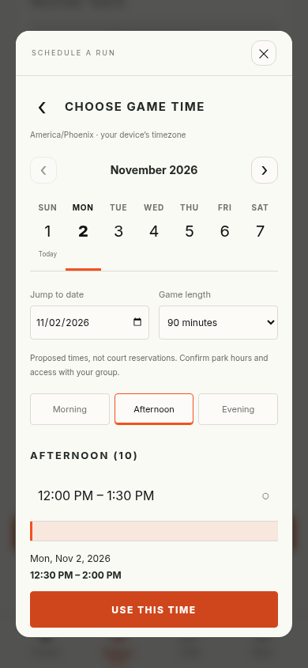
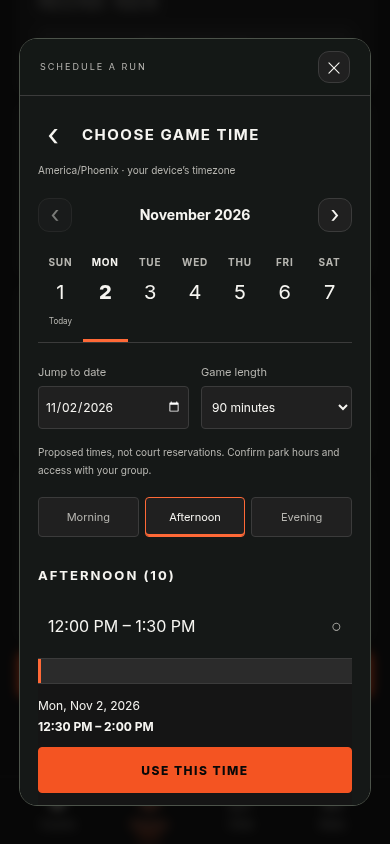
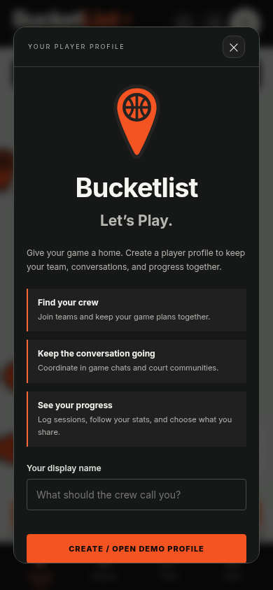
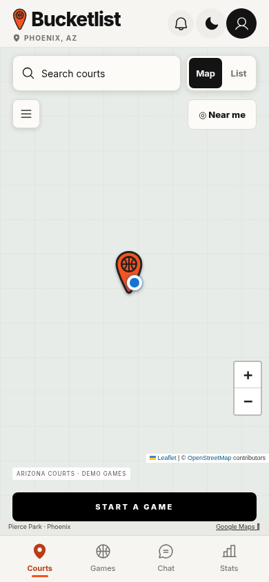
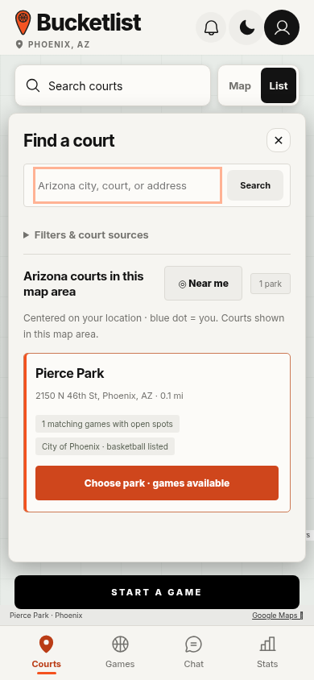
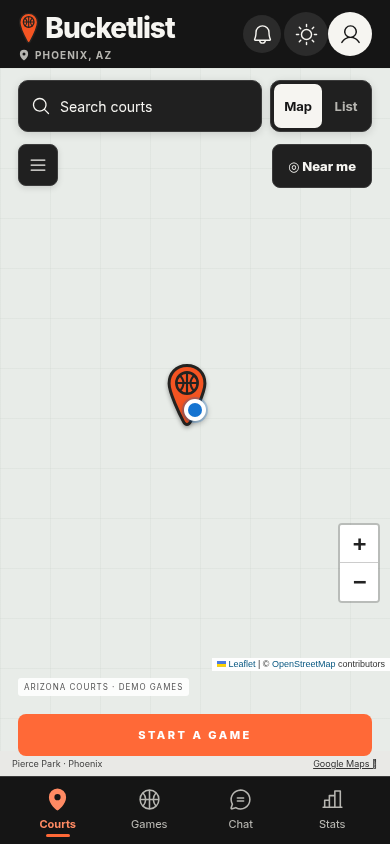
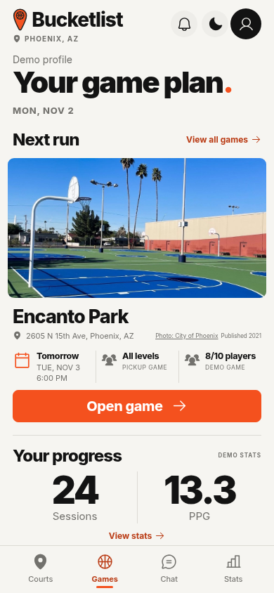
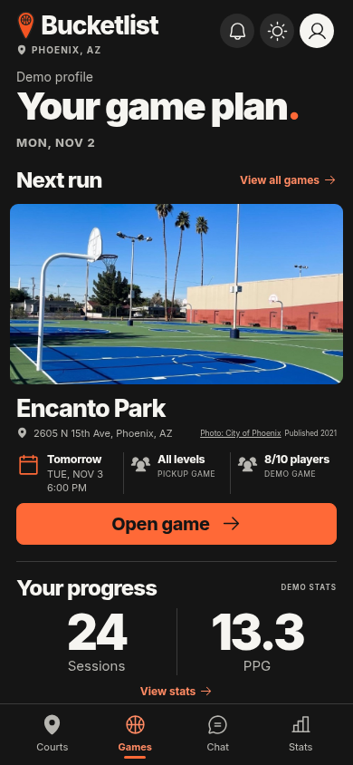

# Bucketlist

Bucketlist opens directly on the **Arizona court map**, with a visible court-search control and a **Map / List** switch. New and returning visitors can browse without an account. When location is permitted, the map centers on the player; otherwise the Phoenix map and manual Arizona search remain available. Four persistent tabs connect **Courts / Games / Chat / Stats**.

Players can now use **+ Add court** to pin a specific basketball court inside an Arizona park, optionally add its photo, and host shared games there. See [court contribution and shared-game instructions](docs/shared-courts.md).

The selected **Game Plan (option 2)** layout remains as an expandable sample in **Games**, with the next run, a photograph of its actual venue, roster and play-style details, and personal progress. Warm off-white, bold Inter typography, orange accents, and a matching dark theme retain the original Bucketlist branding.

## Put it on your phone

**Open Bucketlist: https://adoblake.github.io/bucketlist/**

Source: https://github.com/adoblake/bucketlist. Shared courts and games: https://bucketlist-recovered-oct29.adoblake.chatgpt.site/play/. Shared groups and chat: https://bucketlist-recovered-oct29.adoblake.chatgpt.site/community/.

Court photos: court detail sheets now show aerial photographs centered on each venue’s stored coordinates, fetched from Esri World Imagery. Capture dates and provider credits appear when the source supplies them. Encanto Park also offers a verified basketball-court photograph from City of Phoenix Parks and Recreation; its publication date is distinct from the unknown capture date. Image errors offer retry and Maps/Street View links. No generic image is substituted for an unknown venue. Aerial images require Internet access and represent the provider’s dated photography.

Branding: the original orange basketball pin and single-color **Bucketlist** wordmark are the primary identity. The header keeps the Game Plan placement with a compact lockup; welcome, sign-in, menu, and install screens use the same mark and typography in a stacked lockup. Light and dark themes change the wordmark contrast while preserving the original pin colors.

Appearance and location updates: the header and menu both offer Light/Dark mode, and your choice is saved on this device. New visitors start in the selected light design; existing saved Light, Dark, or device settings are respected. The themed Nearby updates dropdown automatically opens for unseen information in the current area, including location issues, new court listings, and directory failures. Dismiss with Got it, the close button, Escape, or a click outside; reopen it from the header bell. Routine updates do not repeatedly reopen acknowledged notices during the same session.

Arizona edition: court search, new game venues, and live lookups stay within Arizona. Device location is used only when inside the state; blocked embedded views offer a direct browser link. Share and installation links use the current app. Location failures and directory failures have separate messages and recovery actions. The saved directory contains 125 Phoenix locations; broader Arizona coverage still requires the live directory or previously saved results. No complete statewide snapshot was available during this update.

The public app is published on GitHub Pages from the `gh-pages` branch of `adoblake/bucketlist`. Its build includes the install manifest, service worker, app icons, and [QR code for showing/printing](docs/share-qr.png). The canonical public address and repository are defined once in `public/site-config.js`; the standalone fallback, QR codes, preview path, and publisher use that configuration.

- **iPhone:** open the HTTPS link in Safari → Share → Add to Home Screen. Enable Open as Web App if offered.
- **Android:** open in Chrome → menu → Install app / Add to Home screen.
- **Icon:** the same basketball pin used in the app, with only orange and charcoal; no lettering. PNG sizes support home screens, with an SVG favicon for browser tabs.
- **Sharing:** menu → Share app · show QR. Native share and copy-link controls help pass it around in person.
- **Offline:** after a successful first visit, the app shell and local showcase can reopen offline. Maps and live park search still need Internet. The service worker only caches this app's own files, not external map tiles or directory requests.

The hosted phone test was attempted, but this cloud Chromium rejected the environment’s HTTPS proxy certificate. TLS verification was not disabled. Public HTTPS responses were independently verified using the environment’s trusted CA bundle, and mobile subpath/manifest/offline behavior passed against the same build on a local test server. A physical iPhone/Android installation has not been tested.

Player-added court pins, photos, shared games, group membership, and messages use the hosted service and persist across devices. The sample game-plan, calendar, player, and stat tools remain labelled device-local demonstrations. No sample people or conversations are uploaded.

To verify the built phone package locally: run `npm run build:web`, then `npm run preview:web` in a separate terminal, then `npm run test:phone` (set `BROWSER_EXECUTABLE` when using a system Chromium). The default test checks the same repository subpath used by Pages, including offline service-worker reload.

To publish GitHub Pages, commit and push source to `main`, then run `npm run publish:web`. The publisher updates `gh-pages` in the configured GitHub repository without force-pushing. To update the shared community service, run `npm run build:community`, commit and push the Site source, then package the contents of `community-dist/` (including `.openai/` and `dist/`) and publish that exact commit. The Worker manifest declares the `DB` D1 and `BUCKET` R2 bindings; migrations are included under `dist/.openai/drizzle/`. Do not package the frontend `dist/` snapshot as the community Worker.

## Shared groups and chat

The main **Chat** tab and account button open the shared community service. Sign-in uses ChatGPT, including Google through ChatGPT. The Google choice explains that a Google-linked ChatGPT account is required and that it can be created during sign-in. Players then choose a name or nickname; Bucketlist itself asks for no age, gender, religion, phone number, or public email.

Independent **email + one-time code** sign-in is implemented and locally tested, without requiring a ChatGPT account or password. It remains disabled in production until a Supabase auth project and public email sender are configured. See [email sign-in setup and verification](docs/email-sign-in.md) for the exact remaining owner setup, supported runtime settings, identity behavior, and mocked preview screenshots. The existing sign-in choices remain available.

- Create invite-only groups, share an invitation, join, and exchange persistent messages across devices. Only authenticated members can access a group's messages. Live views refresh about every three seconds.
- Group creators can replace invitations, remove members, delete messages, and delete their group. Members can leave and delete their own messages. Server-side validation, capacity checks, send deduplication, and per-account rate limits protect writes.
- Everyone can share the general app link before signing in. Invitation controls belong to group creators.
- Message alerts are opt-in per device and use encrypted Web Push. Notification text does not include private message content. On iPhone/iPad, the community page must be added to Home Screen before enabling alerts. Delivery depends on browser/OS support and notification permission.
- Returning court-app visitors see the release notice once; it can be reopened from **What’s new**. Existing open pages check for later releases. Merely possessing the URL does not make a visitor reachable for closed-app alerts.

The community UI and API share one origin to use platform-owned authentication safely. Public visitors can see the entry page; group data requires a signed-in account and membership. The database stores display names, group memberships, messages, and optional push subscriptions. VAPID key material is generated and retained server-side. It is never bundled in the client.

For local development: `npm run build:community`, then `PORT=3120 node scripts/community-local.mjs`. This loopback-only adapter simulates account identity and uses local SQLite; it is excluded from the deployed Worker. `npm test` covers server permissions and Web Push crypto. `node tests/community-browser.cjs` checks separate browser identities against that local preview. Generate future schema changes with `npm run db:generate`; never modify already-applied migrations.

## Sample calendar and guest-profile flow

The sample scheduler uses a seven-day date strip, previous/next week, optional date jump (180-day planning horizon), Morning/Afternoon/Evening lists, and 30-minute start intervals. Choose a 30/60/90/120-minute duration, confirm the time range, and review it in the game form. Back/cancel preserves form fields and the previously confirmed time. Past times are hidden/rejected; month/year/leap-day and DST boundaries are tested. Times explicitly use the device's timezone, not an inferred park timezone. Start/end instants and duration persist and appear in game views. Proposed ranges are not court reservations or verified park hours.

Guests can browse parks, basic game details, play style, and roster counts. Player identities, personal stats, team participation, and messages require a local demo profile. Contextual prompts explain crew/team continuity, chat, stats, and privacy; a populated showcase can be explored before creating a profile. The prototype profile is saved only in the browser and is not a secure online account. Production enforcement needs authenticated server authorization.

| Light time picker | Dark time picker | Profile benefits |
| --- | --- | --- |
|  |  |  |

## Open it without installing anything

Choose **Code → Download ZIP** on GitHub, extract the archive, and open **BucketList.html** in your browser. The styles and scripts are included in that file. Street map tiles need Internet access. The map uses Leaflet/OpenStreetMap so our basketball pins can be geographically anchored. Google Maps remains available for directions. If tiles are blocked, a status message explains that the court pins remain available; no fake street geography is shown.

Shared courts, games, groups, and chat work across devices through the hosted service. The fictional players, sample game plan, and sample conversations remain labelled device-local demos. This is a web app; native iOS/Android packaging is separate.

## Map opening

| Court map · Light | Nearby court list | Court map · Dark |
| --- | --- | --- |
|  |  |  |

These QA captures block external street tiles and show the neutral map fallback. The deployed app still requests OpenStreetMap tiles; tile delivery is not asserted by the browser tests.

## Game-plan home and navigation

The next run is the earliest future Arizona game you have joined. Otherwise it is an available game within 30 miles of your current or manually selected area. A verified court photograph breaks ties at the same start time. Empty areas offer “Find a court” without substituting a distant venue. The date uses America/Phoenix; scheduling continues to show its explicit timezone. The original photo credit links to the publisher, and its publication date is not presented as a capture date.

Guests see blank personal progress until signing in. Sessions and PPG are calculated from the current local profile; the optional fictional 90-day demo is labeled and stored separately. “View all games” expands the upcoming/history list and scheduling action. The profile button, header bell, theme control, and App menu remain accessible across tabs.

| Selected light layout | Dark layout |
| --- | --- |
|  |  |

See [design QA](design-qa.md) for source comparison, corrections, and validation.

## Opening sequence

First-time and returning visitors open directly to the court map; there is no automatic welcome or signup dialog. Search courts and the Map/List switch stay visible above the map or court list. Detailed filters and source information expand from **Filters & court sources**, leaving nearby court cards visible sooner. The optional two-step introduction remains available under **App menu → About Bucketlist**. The logo returns to the map, and Games opens the game-plan screen. The app requests browser location permission to center on the user, with a blue location dot and accuracy circle. If permission is denied or location fails, an explicit status explains the fallback Phoenix map and manual search remains available. No profile form is mandatory. The default **All basketball parks** mode keeps parks selectable even when no games are scheduled. **Games with open spots** is a separate optional filter. Tap its basketball pin, then tap the court name in the popup for court details, games, and teams. The popup and bottom bar both offer **Start a game**. In Games with open spots mode, time and play-style filters remove pins for full, past, cancelled, or nonmatching games. In All basketball parks mode, game availability does not hide a venue. Availability here does not mean verified live court occupancy. Search opens a court-search overlay with time/play-style filters. Games, Chat, and Stats have bottom tabs. Profile is in the header; the App menu includes showcase, sharing, and appearance actions.

Guests can browse public court/game details. Joining a team, organizing a game, accessing personal screens, and chatting require the clearly labeled **local demo sign-in**. Enter a display name to exercise that sequence, or continue browsing. No account is created, no password is collected, and there is no authentication server. The demo remembers a signed-in profile across reloads and new tabs on the same browser/device; sign-out is in Profile and prevents automatic re-entry. Existing named local profiles migrate to the returning-player flow. Device-local data is retained after sign-out. This UI gate is not a security boundary.

## Explore the populated showcase

Tap **Explore 90-day player demo** on the map or in the menu. It opens the fictional Marcus Rivera profile with 24 self-reported sessions over roughly three months, a progress chart and first/latest-session averages, 1,320 demonstration minutes, three named teams, three court communities, upcoming games, completed session details, and group conversations with fictional participants. Jump from stats to games, chats, or profile.

Showcase state is stored separately from your personal demo state. Its edits survive reloads. **Exit showcase · restore my data** in the menu returns to your preserved personal data. **Restart populated showcase** deliberately restores its starting sample. No fictional performance, attendance, or conversation represents a real person or reservation.

## Where the courts come from

**The bundled Phoenix directory contains 125 basketball locations**, backed by the City of Phoenix Parks and Recreation public GIS. The bundled snapshot preserves all **155 individual court records** and adds parks whose city record lists basketball without a separate court point. Case differences and known naming aliases are merged. These are real city-directory locations; the games, people, and showcase remain fictional.

The original issue was that only five starter venues were bundled and additional results depended on an unreliable Overpass query. Phoenix no longer depends on that query: its directory is part of the app build and offline shell, with no extra button required. Search and map pins show only matching courts inside the current map bounds. Pan/zoom updates results automatically without refitting the camera. All 125 Phoenix entries remain available as you explore or search a destination, and map clusters expand as you zoom. A selected court keeps its orange pin; neighboring pins are grouped to avoid overlap. Parks remain selectable without a game.

Court details show the city source, retrieval date, mapped court count, address, and listed amenities. Coordinates come from actual city basketball points when available; supplemental entries explicitly say **park record**. Source listings do not confirm current access, maintenance, hours, reservations, or live occupancy.

Sources: [City public GIS](https://services.arcgis.com/cfKakmeHE95cgeEK/arcgis/rest/services/ParksOpenData/FeatureServer), basketball layer **0**, park layer **10**; ArcGIS item owned by **City_of_Phoenix**. `public/data/phoenix-courts.js` records retrieval metadata and the public source URL. Update it using `npm run refresh:courts`, then rebuild/publish. The refresh was exercised against the real service and returned 125 locations/155 court records. Node 24's environment-proxy support is used automatically when available; it does not disable TLS verification.

Coverage is currently strongest for **Phoenix city limits**. Scottsdale retains a starter venue. Legacy out-of-state records remain in stored data for compatibility but are excluded from this Arizona edition. Arizona areas can supplement saved entries by automatically requesting tagged basketball courts inside the visible map bounds using OpenStreetMap/Overpass, after a short debounce. Lookups require zoom level 11 or closer and a bounded area. Older requests are aborted when the camera changes; provider failures retain saved results with an explicit status. That external lookup has returned errors/timeouts and is not guaranteed complete. This release does not claim complete coverage of all metro cities or the world. Existing cached court references, saved games, and chat groups are preserved when a duplicate location gets a city-backed entry.

| All Phoenix locations | Search directory | City-backed court details |
| --- | --- | --- |
|  |  |  |

## What you can try

- **Courts:** search Phoenix, Scottsdale, or another Arizona destination; select a sample court, tap its marker/popup, and pan/zoom the map with geographically anchored pins; open court details, directions, scheduled games, or its lasting community chat. Geolocation centers the map on the user; the visible map bounds filter both court pins and search results. The location-arrow button recenters at any time. Destination search moves the map, while court-name search narrows results inside that area.
- **Scheduled games:** join the roster, select/switch between capacity-limited Team A/B, and name your team within that game. Create a future game with a court, player limit, play style, and meeting/access notes.
- **Chat:** separate court-community and game-group conversations, plus a central chat list.
- **My stats:** log and delete personal session records for points, rebounds, and assists; see self-reported averages and history.
- **Profiles:** open a player from a roster. Fictional examples demonstrate public and private profiles/stats. Your profile details and stats have independent sharing settings, both off by default; preview what others would see. Display names remain visible on rosters.
- **Appearance:** use the header or App-menu toggle, or select Light, Dark, or Use device setting in Profile, then save. Themes persist. The street basemap retains its readable provider styling in both themes. The map footer credits OpenStreetMap tiles; Phoenix location details separately credit the city directory.

## Screenshots

Captured on a mobile viewport. Street tiles are blocked in the cloud screenshots. Markers are geographically projected against a neutral grid; it is not street imagery.

| Opening map | Court popup | Court details |
| --- | --- | --- |
|  |  |  |

| Teams | Demo sign-in | Light theme |
| --- | --- | --- |
|  |  |  |

## Development

Requires Node.js 22.13+ and npm.

```sh
npm ci
npm start
```

Open the server on port 3000 (`PORT` overrides it). The server uses Node built-ins. Leaflet 1.9.4 is pinned and its licensed distribution is bundled in public/vendor/leaflet so the standalone artifact needs no CDN scripts. Playwright is a development-only dependency.

```sh
npm test                 # HTTP, game-plan selection, calendar, capacity, privacy, and stats tests
npm run build            # regenerate the downloadable BucketList.html
```

Browser regression checks require a running server and Chromium:

```sh
# Terminal 1
PORT=3090 npm start
# Terminal 2, if Chromium is already installed
APP_URL=http://127.0.0.1:3090 BROWSER_EXECUTABLE=/usr/bin/chromium npm run test:browser
```

If no Chromium is installed, run `npx playwright install chromium` and omit `BROWSER_EXECUTABLE`. The browser suite checks opening Courts from the new home, guest browsing, local-demo sign-in gates/cancel/resume/sign-out, and team switching/naming, separate chats, profile visibility, stats, persistence, destination search, themes, responsive overflow, and the standalone artifact. Run `APP_URL=http://127.0.0.1:3092 BROWSER_EXECUTABLE=/usr/bin/chromium npm run test:showcase` with a server on 3092 for the populated-showcase and fixture-directory regression. Marker projection, keyboard activation, viewport filtering, and availability filters are checked; run `APP_URL=http://127.0.0.1:3097 npm run test:location` against a server on 3097 for direct map opening, Map/List controls, permitted/denied geolocation, pan/zoom/list agreement, destination discovery, recenter, saved appearance, and Games/Chat navigation. External tile availability is not asserted because the cloud environment blocks the tile provider.

The Games-screen regression is `APP_URL=http://127.0.0.1:3090 node tests/game-plan-browser.cjs`; it checks the next run, guest/sign-in/join, roster and stats updates, four tabs, map center, showcase isolation, saved theme, and responsive widths. `tests/appearance-notices.cjs` covers location-scoped notifications and keyboard dismissal.

## Maps and privacy boundaries

The map uses Leaflet 1.9.4, Leaflet.markercluster 1.5.3, and OpenStreetMap street tiles with visible attribution, custom geographic basketball pins, pan/zoom, court popups, a current-location marker, and viewport-scoped results. Popups and result updates do not move the camera. Google Maps directions open only when requested. No Maps API key is required for this prototype. A custom Google-powered map can replace this provider when the required API configuration is supplied. Public OSM tiles have a usage policy and no app-specific uptime guarantee; production must provision an appropriate provider.

Phoenix coordinates and amenity labels come from city records; starter-venue coordinates elsewhere remain unverified. Current access, hours, occupancy, and conditions are not verified. All basketball parks is the default directory mode. The separate Games with open spots mode uses future scheduled games and selected day/style. Neither mode claims live court occupancy. Self-reported sample availability is not a court reservation. In Games with open spots, pins and list both exclude courts without a matching game; switch to All basketball parks to see those venues.

Precise user coordinates stay in memory and are not saved in the profile; there is no background tracking. Visible map bounds are sent to Overpass for area discovery for the visible area, and destination text goes to Nominatim. Normal map viewport tile requests go to OpenStreetMap; opening directions sends the chosen public venue to Google. Stats/profile visibility remains a local UI demonstration, not server authorization. The separate shared community service enforces its group membership and message permissions on the server. Shared game rosters enforce capacity on the server. Court reservations and personal-stat synchronization remain future work.

See [UX decisions and standard references](docs/UX-DECISIONS.md) for the applied conventions, source-access limitations, and remaining production work. The new published Figma site also could not be retrieved through the cloud proxy.

## Showcase screenshots

| Player stats and progress | Upcoming games and history |
| --- | --- |
|  |  |

## Next production milestones

Synchronized personal stats and profiles; waitlists; broader reporting and moderation; verified courts/accessibility; native packaging and physical-device push testing.

The business plan and layout screenshot informed this version. The Figma links and reference GitHub repository were inaccessible. See [PRODUCT.md](PRODUCT.md) for the product direction.
