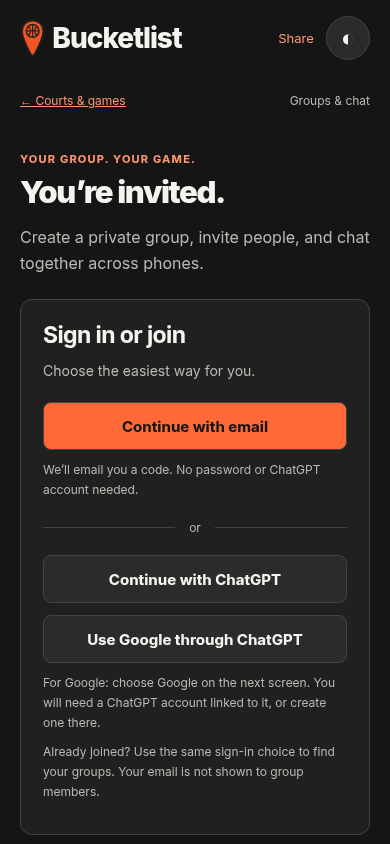
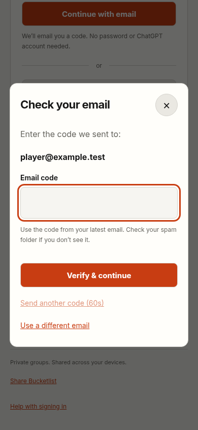

# Independent email sign-in

Implemented in the community Worker and UI; **public email sign-in is disabled until a real auth project and public email delivery are configured**. ChatGPT and Google-through-ChatGPT keep working. Connecting the Supabase plugin does not by itself configure email delivery.

## Player experience

Choose **Continue with email**, enter an email address, and enter the one-time code from the inbox. New and returning players use the same form. No ChatGPT account or new password is required. New players choose a display name once; invitations survive the whole flow. Resending, changing the address, errors, and sign-out have explicit controls. Light and Dark mode are supported.

Existing ChatGPT identities retain their profiles and groups. Email identities are separate; accounts are never merged automatically by matching email. Returning players should use their original sign-in choice to find existing groups.

## Owner setup still needed

1. Connect Supabase and select or create the auth project. Enable Email authentication and new user signup.
2. Configure **custom SMTP or a Send Email hook** using a delivery provider and a sender you control. Complete that provider’s sender/domain verification. Supabase’s default SMTP only delivers to project-team addresses and is unsuitable for public signup.
3. In **Authentication → Email Templates → Magic Link**, make the code prominent with `{{ .Token }}`. For example: `Your Bucketlist code is {{ .Token }}. Enter it in the app to continue.` This app uses codes, so a magic-link-only template is insufficient. Use an appropriately short OTP expiration, such as 10 minutes, and retain provider abuse limits.
4. Set the Site URL to `https://bucketlist-recovered-oct29.adoblake.chatgpt.site/community/` and allow that same return URL. Use the provider’s sending tools to verify delivery to an inbox outside the project team.
5. Configure production runtime values through Sites environment settings:

   | Name | Value |
   | --- | --- |
   | `SUPABASE_URL` | The project’s HTTPS API origin |
   | `SUPABASE_PUBLISHABLE_KEY` | Its publishable key, or legacy `anon` key |
   | `EMAIL_AUTH_ENABLED` | `true`, after sender setup is complete |

   Never use a service-role or `sb_secret_` key. Do not put credentials in the repository, browser code, or chat messages. Deploy the saved Worker version again after changing runtime settings; Sites applies runtime changes on deployment.

6. From the live community page, test a new non-team inbox and a returning account, consume the code, choose a name, join an invitation, reload, and sign out. Check spam-folder placement and actual delivery time. **No real verification email has been sent or delivery-tested during this implementation.**

If configuration is missing, invalid, or disabled, the email button is hidden and the send endpoint returns a clear unavailable response. Set `EMAIL_AUTH_ENABLED=false` and redeploy to disable email sign-in and email-authenticated access if needed. Email-owned groups and messages remain stored. This does not affect native ChatGPT sign-in.

## Session and privacy behavior

The Worker uses the official `@supabase/ssr` and `@supabase/supabase-js` packages for verification, refresh, and sign-out. Tokens are confined to HttpOnly, Secure, SameSite=Lax cookies on the community origin. The browser does not receive them in API JSON or save them in localStorage. Every authenticated email request uses the provider’s `getUser()` and requires a confirmed email. Cookie claims alone never grant access. Responses, including refreshed session cookies, are `no-store`.

The existing D1 membership checks authorize both account types. Stable email actors use `email:<provider-user-id>`; native actors retain `chatgpt:<site-user-id>`. A native session takes precedence over leftover email cookies and clears those cookies, avoiding a surprise account switch after native sign-out. Email verification never updates another identity’s profile or membership.

Email addresses are sent to the managed auth provider for verification. They are not added to public profiles, group responses, or chat messages. D1 abuse counters use hashes of normalized email addresses and request IPs; these counters are not an anonymization guarantee. Per-IP, per-email, code-attempt, resend, and provider limits apply. Cross-origin writes are rejected. Provider delivery errors do not disclose whether an address has an account.

## Validation

`tests/email-auth.test.js` exercises the real SDK against an in-memory mock provider: verified email access, cookie flags, refresh, revocation, sign-out, forged/unconfirmed identities, native coexistence, group exchange, rate limits, and delivery failure responses. It cannot prove real SMTP delivery.

`tests/email-auth-browser.cjs` exercises the UI with a fake same-origin API: new/returning flow, failures and retry, resend cooldown, change address, code autocomplete, invitation preservation, sign-out, themes, and 320–1280px layouts. `tests/community-browser.cjs` independently exercises the real local Worker’s existing native group/chat flows. Both run against the loopback preview after `npm run build:community`.

Preview images use fake data and a mocked API; they do not indicate enabled production email:

| Email option | Code entry |
| --- | --- |
|  |  |

Official references: [Supabase email OTP](https://supabase.com/docs/guides/auth/auth-email-passwordless), [SMTP requirements](https://supabase.com/docs/guides/auth/auth-smtp), [server-side auth](https://supabase.com/docs/guides/auth/server-side/creating-a-client), [session guidance](https://supabase.com/docs/guides/auth/server-side/advanced-guide).
